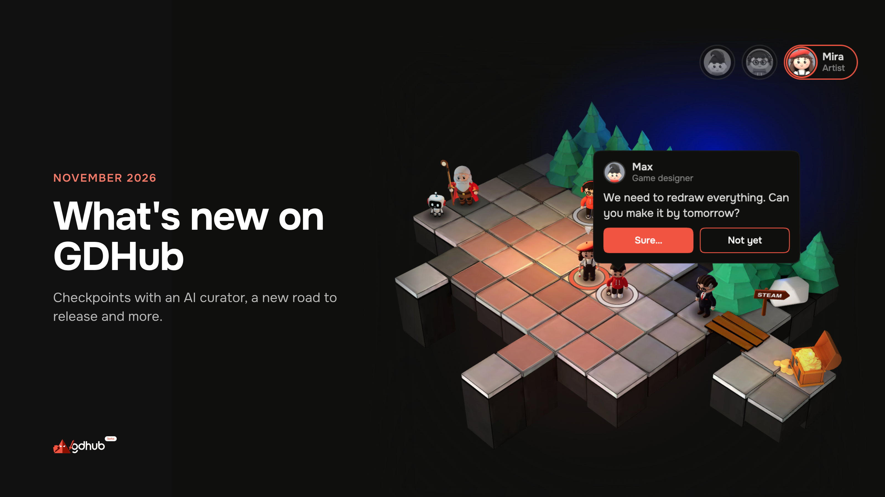
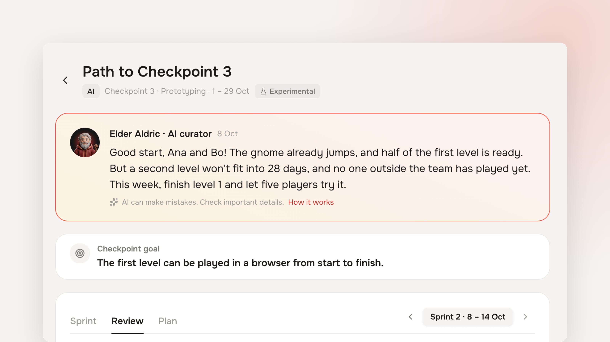
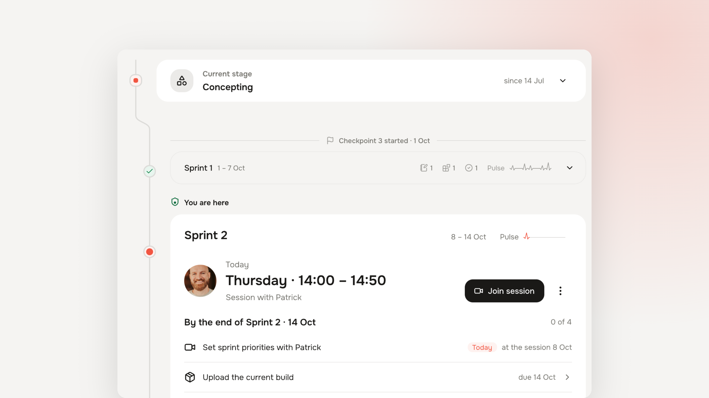

# What's new on GDHub — November 2026

*November 5, 2026 · GDHub team*

This release is the biggest since GDHub moved to spaces. The headline is **Checkpoints**, now open in experimental mode. Around them, we redrew your project's road and reworked the header, open positions, the landing and our legal pages.

- [**Checkpoints, in experimental mode**](#checkpoints-in-experimental-mode): 28 days, one goal, one verdict — with an AI curator for now
- [**Your project's road, redrawn**](#your-projects-road-redrawn): stages, checkpoints and team activity on one page
- [**Your time investment, in the header**](#your-time-investment-in-the-header)
- [**Open positions: withdraw an application**](#open-positions-withdraw-an-application)
- [**A new gdhub.io**](#a-new-gdhubio)
- [**Legal pages and certificates**](#legal-pages-and-certificates)
- [**Smaller improvements**](#smaller-improvements)

---

## Checkpoints, in experimental mode

Most indie projects don't fail in one day. They drift: a month goes by, the build looks a little different, and nobody can say whether the game is closer to release.

A **Checkpoint** is 28 days with one goal set on day 1 and one verdict at the end. You pick the stage your game is in, write what you want to reach, and plan up to five tasks that get you there. The 28 days split into four one-week sprints, and every sprint the curator reviews what changed. On day 28 you get the verdict: goal reached or not, and why.

A missed goal doesn't erase anything. A checkpoint is a save point: the next one starts from where this one ended.

Checkpoints are planned with two kinds of curator — an AI and a human industry expert. **Right now only the AI curator is available.** Expert checkpoints are coming: choose an expert and join the waitlist, and we'll write to you when they open. Checkpoints are experimental, and the AI can make mistakes — we'd rather say so than pretend otherwise.

- **Price:** $20 for the whole 28 days, the same for a team of 1 or 10.
- **Who can head for one:** any project on GDHub past the Introduction stage.

### What you get during the 28 days

- **A check on day 1.** The curator reads your goal and tells you whether it fits your stage, and whether each task actually leads to it. You can adjust both before the plan is approved. On day 15 you get one more chance to change the plan.
- **A review every sprint.** The curator reads the whole project, not only the tasks: devlogs, builds and videos, the evidence you attach, the team and its open positions. Each review looks at four sides of the project — development, marketing, team and project management — so a finished plan that didn't move the game forward doesn't go unnoticed.
- **Path to Checkpoint** — one page with every sprint: the plan, the tasks with up to three pieces of evidence each, the curator's review and the team's activity.
- **A calendar** with every deadline. Subscribe once and it stays in sync, or add single dates to Google Calendar, Outlook or Apple Calendar.
- **A verdict you can share.** When the checkpoint closes, **Share the result** gives you a card with the curator's line about your work and your project's cover, plus a ready post with a link to your project — for LinkedIn, X, Telegram or anything else. Nothing leaves GDHub unless you post it.

[Head for your first checkpoint →](https://gdhub.io/checkpoint)

## Your project's road, redrawn

The **Workflow** page is now your project's road to the release. Stages, sprints and checkpoints sit on one line, and every stage says when the project was on it. The road ends at **Release**; Support appears once the game is out.

Beside the road you see the running checkpoint and the project's activity — who joined, who invited them, what changed. Each stage now carries its own description and goal, so you know what it expects before you plan.

## Your time investment, in the header

The hours you're ready to invest each week — in your own projects or in other authors' — now sit in the header, for example "10–15 h/wk". One click to change them, or to switch **Open to other authors' projects** on or off. Authors weighing a candidate, and checkpoints planning a team's capacity, now see current numbers instead of what you typed in settings a year ago.

## Open positions: withdraw an application

Applied to a position and changed your mind? You can now withdraw your application from the position page, instead of being stuck with "You have already responded".

## A new gdhub.io

The landing finally describes the platform as it is today: the spaces — Project, Advisor and Scout — the hub with its talent, the Checkpoint, and what each audience gets: authors, specialists, publishers and investors, and industry experts. The hero is a small playable board with our cast of characters. Open positions on the landing got new cards.

## Legal pages and certificates

- **/legal** lists every document with its versions. Under **Settings → My documents** you see what you accepted and until when it applies.
- When a document changes, we ask you once to accept the new version.
- Certificates for events, courses and checkpoints come from one place and can be checked by anyone at **/verify**.

## Smaller improvements

- **One unread dot** for chat and notifications in the header.
- **Scouts** see a project's checkpoint history — goals, verdicts and curators — in the project window.
- And other small changes and fixes across the platform.
---

Try it, break it and tell us what you think — in the chat or at the bottom of any page. See you on the road to the release.
