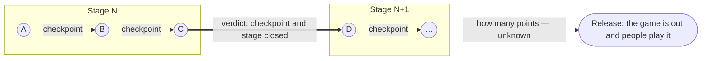
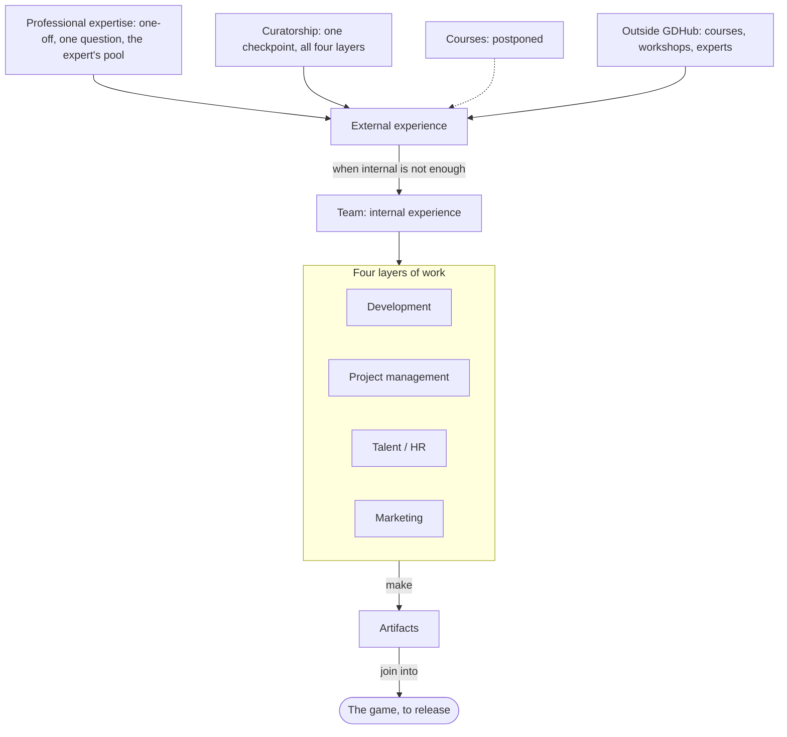

# How GDHub sees game development

The model the whole platform is built on. Every space, feature and AI prompt is a
piece of it; when a new feature does not fit somewhere below, either the feature or
this page is wrong.

## The process

Making a game is a **process**. It runs through sequential stages; on each stage the
team makes parts of the game, and the parts gradually join into a game that goes to
release.

| Term | Meaning |
|---|---|
| **Workflow** | The development process of one project: an ordered list of stages, one of them current. |
| **Stage** (stage of workflow) | One step of the workflow, with what it is for, the goal it has to leave the project at, and the tasks it requires before the project may move on. |
| **Default workflow** | The workflow template every project starts from: Introduction → Ideation → Concepting → Prototyping → Preparing a demo version → Taking and analyzing metrics → Preparing a release version → Support → Project Completion. |
| **Artifact** | A part of the game made on a stage: a design document, a prototype, a build, a trailer, a store page. |
| **Project goal** | Where every stage leads: *the game is released and people play it.* |

## How a project moves: checkpoints

A project moves from stage to stage through **checkpoints**. A checkpoint takes the
project from point A to point B; a stage may take one checkpoint or several. How many
points lie between the start and the release nobody knows in advance — the path is
found one checkpoint at a time.

When a checkpoint sees that both it and the stage are closed — its own goal met, and
the stage's goal reached with its required tasks done — it says so in its verdict:
the project may move to the next stage. A
checkpoint that ends short of that is a normal outcome, not a failure; the next one
runs on the same stage.

## Experience

The team makes artifacts with its **internal experience** — what its members already
know how to do. When that is not enough, the team turns to **external experience**:
courses, workshops, consultations with experts — on GDHub or outside it.

## Four layers of work

Work on a project, across the whole workflow, splits into four layers:

| Layer | The question it answers |
|---|---|
| **Development** | Making the artifacts. |
| **Project management** | Which artifacts to make, and when. |
| **Talent / HR** | Is there anyone to make them? Train someone, open a vacancy, let someone go, ask someone for more hours. |
| **Marketing** | Building the game's audience, so that at release there is someone to play it. |

Each stage weighs the layers differently: on Ideation marketing barely matters, on a
demo or a release it matters as much as development.

## External experience on GDHub

External experience can cover any of the four layers. GDHub gives it in two ways:

| Form | What it is |
|---|---|
| **Professional expertise** | A one-off consultation with an expert on a concrete question. Every expert has their own pool of questions they are competent in. |
| **Curatorship** (checkpoint) | Guidance over a period of time — one checkpoint, from point A to point B. A curator usually covers all four layers, one of them more strongly than the rest. |

**Courses** are the third form and are postponed.

## Where the model lives in the product

| Concept | Where |
|---|---|
| Project, team, workflow, moving between stages | [project/README.md](project/README.md), `src/repositories/project/`, `src/services/workflow/` |
| Project goal, stages and how each weighs the layers | `PROJECT_GOAL`, `CURATOR_LENSES`, `CURATOR_LENS_WEIGHTS` in [src/config/checkpoint.ts](../src/config/checkpoint.ts) |
| Layers as the curator's four lenses | [checkpoints-four-lenses-flow.svg](checkpoints-four-lenses-flow.svg), `LENSES` in [src/services/checkpoints/ai-curator/prompts/card.ts](../src/services/checkpoints/ai-curator/prompts/card.ts) |
| Curatorship | [checkpoints.md](checkpoints.md), [checkpoint-standard.md](checkpoint-standard.md) |
| Professional expertise | [advisor-space.md](advisor-space.md), `/hub/experts` |
| Talent layer: vacancies, team | [paid-vacancies.md](paid-vacancies.md), [team-invitations.md](team-invitations.md) |
| Spaces that carry all of the above | [spaces.md](spaces.md) |

In code the Talent / HR layer is called **team** (`CuratorLens = "team"`).
