# Юридический слой платформы

_Черновик архитектуры. Версия 0.1 — 13 сентября 2026. Написан по-русски временно,
переводится на английский перед тем, как станет частью `docs/`._

Как устроена работа с юридическими документами на gdhub: какие документы бывают, чем
они подтверждаются (галочка или подпись), как хранятся, и что происходит в каждом
пользовательском сценарии.

Документ описывает **механику**, а не тексты. Сами тексты живут рядом:
[terms-of-use.md](terms-of-use.md), [advisor-agreement.md](advisor-agreement.md),
[checkpoint-terms.md](checkpoint-terms.md). Нерешённые юридические вопросы —
в [open-points.md](open-points.md), сюда они не дублируются.

---

## 1. Шесть принципов

1. **Один реестр.** Каждый юридический документ описан в коде одной записью: код, кому
   он адресован, каким событием вызывается, чем подтверждается. Реестр — такой же, как
   реестр спейсов (`src/config/spaces`). Добавление документа не трогает общий код.
2. **Способ подтверждения выбирается по риску, а не по привычке.** Галочка там, где
   условия задаёт одна сторона. Подпись там, где условия индивидуальны, или где документ
   должен жить за пределами платформы.
3. **Принятое замораживается навсегда.** Пользователь принимает не «документ», а
   конкретную версию конкретного текста. Текст, его хэш, время, IP и user-agent
   сохраняются. Ни одна опубликованная версия не удаляется и не правится.
4. **Платформа не становится стороной без необходимости.** В договоре между командой и
   участником платформа — инструмент, а не сторона. Там, где платформа продаёт
   (Checkpoint, платные вакансии, курсы), она сторона явно и целиком.
5. **Документ привязан к спейсу, а не к экрану.** Событие «участник вступил в проект»
   и «студент вступил в курс» — одна и та же механика с разным шаблоном. Ни один флоу
   не пишет свою собственную работу с документами.
6. **Всё, что выдаётся наружу, проверяемо.** У сертификата есть номер и публичная
   страница проверки. PDF без страницы проверки — картинка, а не документ.

---

## 2. Карта документов: четыре слоя

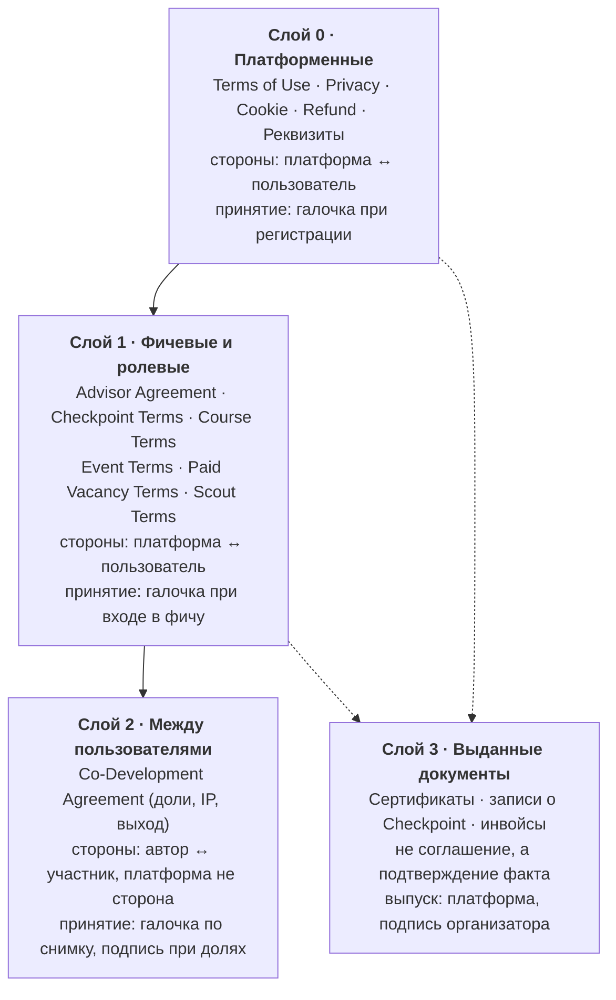

**Иерархия при конфликте:** специальный документ побеждает общий. Terms of Use — рамка;
условия фичи уточняют её для своей фичи; индивидуальный договор между пользователями
уточняет то, о чём Terms of Use вообще не говорит. Эта фраза должна быть **написана в
каждом документе слоя 1 и 2**, иначе она не работает.

### 2.1 Инвентарь

| Документ | Слой | Стороны | Когда предъявляется | Подтверждение |
|---|---|---|---|---|
| Terms of Use | 0 | платформа ↔ user | регистрация | галочка |
| Privacy Policy | 0 | — (информирование) | регистрация, футер | ссылка в той же галочке |
| Cookie Policy + баннер | 0 | — (согласие GDPR) | первый визит | **отдельный** механизм согласия |
| Refund Policy | 0 | платформа ↔ user | чекаут | ссылка |
| Legal Details (реквизиты) | 0 | — | футер | — |
| Advisor Agreement | 1 | платформа ↔ advisor | включение Advisor Space | галочка |
| Checkpoint Purchase Terms | 1 | платформа ↔ автор | чекаут Checkpoint | галочка + чекбокс отказа от периода охлаждения |
| Course Terms | 1 | платформа ↔ студент | запись на курс | галочка |
| Event Participation Terms | 1 | платформа ↔ участник | регистрация на событие | галочка |
| Paid Vacancy Terms | 1 | платформа ↔ покупатель | чекаут вакансии | галочка |
| Scout / NDA-lite | 1 | платформа ↔ скаут | включение Scout Space | галочка |
| Co-Development Agreement | 2 | автор ↔ участник | создание проекта, вступление, смена долей | галочка по снимку; подпись при долях |
| Сертификат участия / завершения | 3 | выдаёт платформа | завершение события, курса, Checkpoint | подпись организатора |
| Инвойс | 3 | выдаёт платформа | оплата | — |

Всё, чего нет в таблице, не существует. Новый документ добавляется в таблицу и в реестр
в коде одновременно.

### 2.2 Трёхсторонние договоры

Соблазн есть — автор, куратор и платформа; студент, преподаватель и платформа. **По
умолчанию мы их не делаем.** Трёхсторонний договор требует трёх подписей, ломается, если
одна сторона выбывает, и не даёт ничего, чего не дают два двусторонних.

Правило: **два двусторонних договора со ссылкой друг на друга**. Так уже решено по
Checkpoint — автор покупает у платформы, куратор нанят платформой, автор с куратором
не связан договором вовсе.

Трёхсторонний документ оправдан только там, где обязательство действительно общее и
неделимое: например, платформа держит деньги в эскроу, а условия выплаты зависят от
согласия обеих сторон. До появления эскроу этого случая у нас нет.

### 2.3 Договоры между пользователями без платформы

Технически возможно и предсказуемо будет запрошено: NDA между командами, договор о
передаче прав на ассет, договор с подрядчиком вне платформы. Позиция:

- платформа даёт **шаблон и подпись**, но не является стороной и не проверяет содержание;
- в интерфейсе это отдельный раздел «Документы» в спейсе с явной надписью «gdhub не
  является стороной этого документа и не проверяет его»;
- это **третий этап**, не раньше. Механика та же, что у слоя 2, меняется только источник
  шаблона: его выбирает пользователь, а не платформа.

---

## 3. Галочка или подпись

### 3.1 Правило выбора

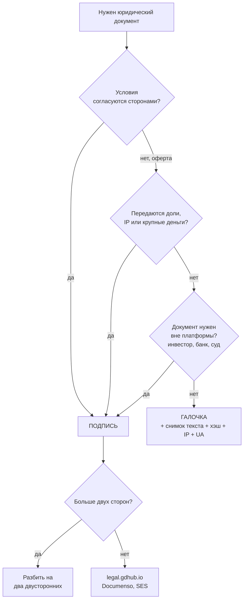

### 3.2 Галочка (clickwrap)

Покрывает всё, что платформа предлагает на своих условиях. Суды признают галочку, если
она оформлена правильно, и отказывают, если нет — разница целиком в деталях интерфейса.

**Требования к интерфейсу** (все обязательны, не «желательно»):

- чекбокс **не предустановлен**;
- текст согласия рядом с чекбоксом называет документ и содержит рабочую ссылку;
- документ открывается **до** принятия, без регистрации и без скачивания;
- действие отдельное — «Принять» не должно быть склеено с «Далее» без явной формулировки;
- по каждому документу — своя галочка, если документы разной природы (оферта и согласие
  на обработку данных не объединяются).

**Что записывается в момент принятия** (иначе принятия не было):

| Поле | Зачем |
|---|---|
| `userId` | кто |
| `acceptedAt` (UTC, ISO 8601) | когда |
| `ipAddress` | откуда |
| `userAgent` | чем |
| `templateCode` + `version` + `locale` | что именно |
| `contentChecksum` (SHA-256 текста) | доказательство, что текст не изменился |
| `context` | по какому событию (регистрация, вступление, чекаут) |
| `snapshotId` | какой отрендеренный экземпляр видел пользователь |

### 3.3 Подпись

Свой инстанс **Documenso на legal.gdhub.io**. Уровень — простая электронная подпись
(SES). Этого достаточно: по eIDAS и по ESIGN/UETA простая подпись с полным журналом
действий годится для договоров такого рода. Усиленная (AES) и квалифицированная (QES)
подпись нам не нужны и не планируются; если когда-нибудь понадобятся, это смена
провайдера, а не архитектуры.

Что делает Documenso и чего не делает:

- **делает:** хранит PDF, собирает подписи по порядку, ведёт журнал, отдаёт подписанный
  файл, умеет шаблоны, прямые ссылки на подписание и встраивание в наш интерфейс;
- **не делает:** не является нашей базой данных. Состояние документа дублируется у нас —
  кто сторона, в каком статусе, к какому спейсу относится. Documenso хранит файл и
  журнал, мы храним смысл.

Риск самостоятельного хостинга — потеря инстанса. Отсюда требование: **подписанный PDF
скачивается и сохраняется у нас сразу после закрытия конверта**, а не по ссылке при
каждом открытии. Код для этого уже есть (`downloadSignedDocument`).

---

## 4. Модель данных

### 4.1 Что уже есть

В `@gdhub-io/gdhub-prisma` лежит рабочая основа, но она привязана к проекту:
`LegalDocumentTemplate` → `ProjectLegalSnapshot` → `LegalAcceptance` +
`ProjectLegalEvent`. Плюс отдельно `EventCertificate` — сертификат, живущий своей жизнью
и знающий только про событие.

Это ровно та структура, которая нужна, с двумя ограничениями: она знает только слово
«проект» и не описывает подпись.

### 4.2 Что предлагается

Обобщить «проект» до «спейса» и добавить сторону документа. Новых сущностей — одна.

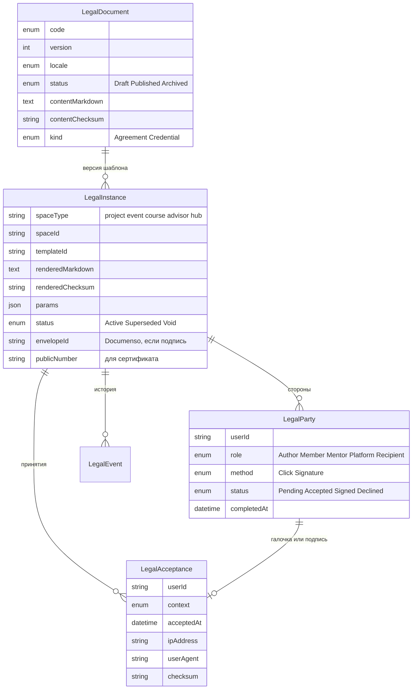

**Что меняется по сравнению с текущей схемой:**

| Сейчас | Становится | Зачем |
|---|---|---|
| `ProjectLegalSnapshot.projectId` | `LegalInstance.spaceType + spaceId` | курс и событие получают ту же механику без новых таблиц |
| `ProjectLegalEvent` | `LegalEvent` (тот же, со спейсом) | история читается одинаково везде |
| `LegalAcceptance.projectId` | ссылка только на `instance` | проект выводится из инстанса, дублировать незачем |
| — | `LegalParty` | до подписи нужно знать, от кого её ждут; это же поле показывает «ждём вторую сторону» |
| `EventCertificate` | `LegalInstance` с `kind = Credential` | сертификат из любого спейса, а не только из события |

**Чего сознательно не добавляется:** отдельной таблицы подписи (состояние подписи — это
поля `LegalParty`), отдельной таблицы сертификата, версионирования параметров рендера,
шаблонов, принадлежащих пользователям. Всё это появится, когда появится нужда.

### 4.3 Реестр в коде

```ts
// src/config/legal/registry.ts — форма записи, не финальный код
{
  code: "CoDevelopmentAgreement",
  kind: "Agreement",
  space: "project",
  trigger: "project.create" | "project.member.join" | "project.equity.change",
  method: "click",              // "signature" — когда появятся доли
  parties: ["Author", "Member"],
  platformIsParty: false,
  params: ["projectTitle", "shares", "authorName"],
}
```

Реестр — источник правды для: гейта в интерфейсе, страницы `/legal/*`, админки,
проверки «этот пользователь принял всё, что должен», и сидера шаблонов.

### 4.4 Сертификаты как частный случай

Сертификат отличается от соглашения тремя вещами и больше ничем:

- у него один **получатель**, а не две стороны, и получатель ничего не принимает;
- подписывает его **выдающая сторона** (организатор, куратор, платформа);
- у него есть **публичный номер** и страница проверки.

Поэтому сертификат — это `LegalInstance` с `kind = Credential`, у которого стороны
`Recipient` (без подписи) и один-два `Issuer` (с подписью). Всё остальное — шаблон,
снимок текста, хэш, конверт Documenso, хранение PDF — работает без изменений.

Следствие, ради которого всё и затевалось: **сертификат выдаётся из любого спейса**.
Событие, курс, Checkpoint, проект — разница только в шаблоне и в том, кто подписывает.

Open Badges 3.0 и верифицируемые учётные данные — **не сейчас**. Публичная страница
проверки закрывает 95% потребности; переход на криптографически подписанный бейдж
осмыслен, когда сертификаты начнут предъявлять вне платформы систематически.

---

## 5. Жизненный цикл версии

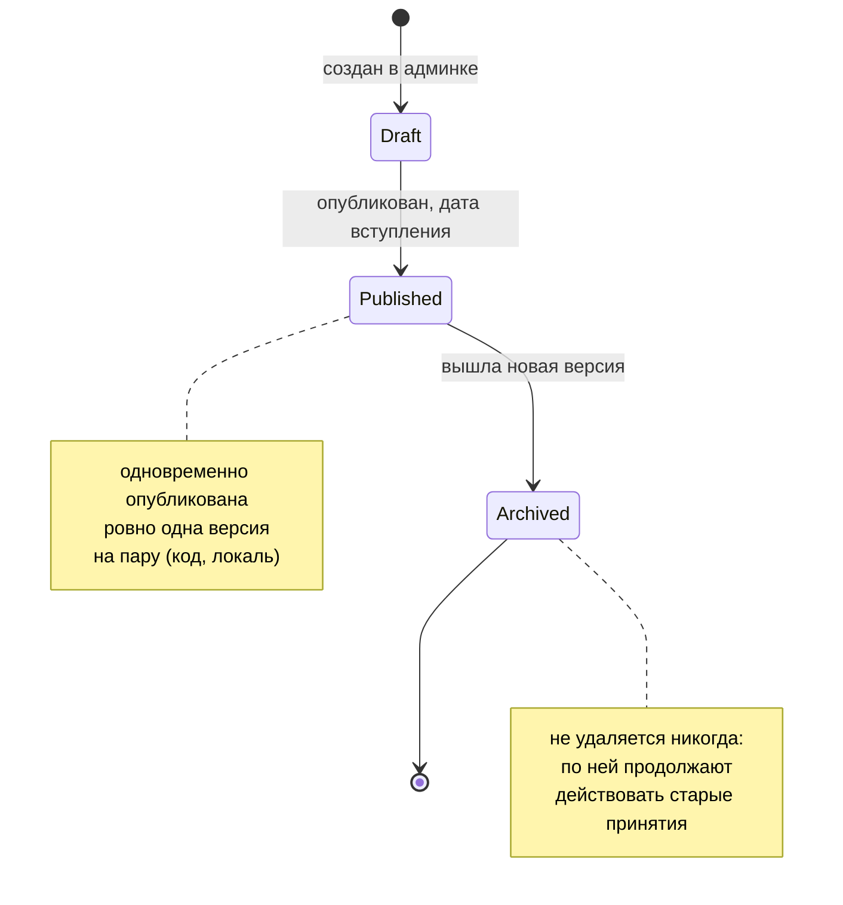

Правила:

- **Идёт по той версии, что действовала на старте.** Запущенный Checkpoint, действующий
  договор о совместной разработке, активный курс — доигрывают на своей версии. Новая
  версия применяется к новым отношениям.
- **Существенное изменение → повторное принятие.** Пользователь видит гейт при следующем
  входе и не может пользоваться затронутой фичей, пока не примет. «Продолжение
  использования = согласие» без уведомления не работает.
- **Несущественное изменение → уведомление**, без гейта. Что считать существенным,
  решается при публикации и записывается в самой версии (`materialChange: boolean`).
- **Срок уведомления:** 30 дней для потребителей, 15 дней для деловых пользователей
  (требование регламента P2B, если он к нам применим — см. open-points).
- **Локали.** Версия существует в паре (код, локаль). Для резидентов Литвы литовская
  версия должна существовать до запуска, потому что в текстах уже написано, что она
  имеет преимущество.

---

## 6. Пользовательские сценарии

Девять сценариев покрывают всё, что есть и планируется. Каждый — одна и та же механика.

### F1. Регистрация — принятие платформенных документов

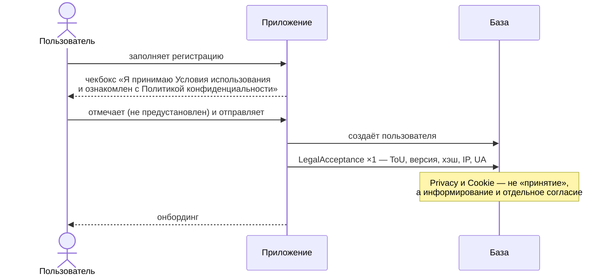

Согласие на cookie — **отдельный** механизм баннера, никогда не в этой галочке. Основание
обработки данных по договору — исполнение договора, а не согласие; смешение двух вещей
ломает и то и другое.

### F2. Вышла новая версия Terms of Use

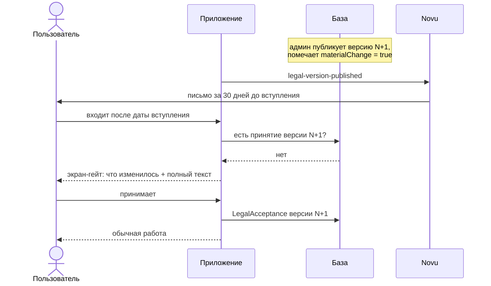

Если изменение несущественное — письмо есть, гейта нет.

### F3. Создание проекта — договор о совместной разработке

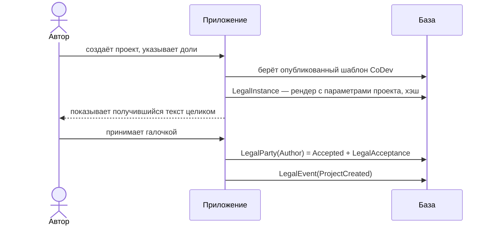

Ключевое: автор видит **свой** договор с подставленным названием проекта и долями, а не
абстрактный шаблон.

### F4. Вступление в команду — по приглашению или через вакансию

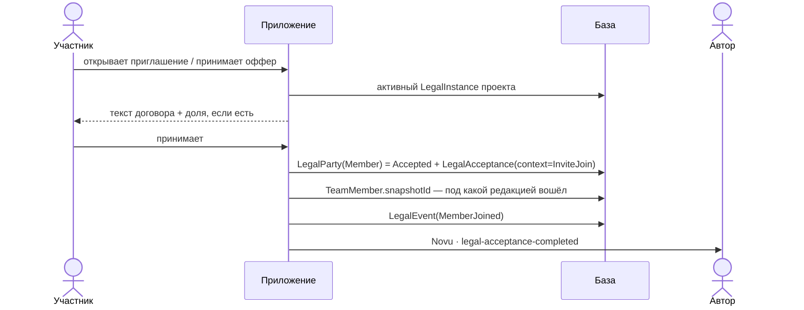

`TeamMember` хранит ссылку на инстанс. Через год будет видно, на каких условиях человек
вошёл, даже если договор с тех пор менялся трижды.

### F5. Смена долей или исключение участника

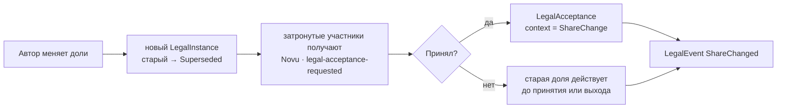

Изменение долей **не вступает в силу молча**. Пока участник не принял — действует
предыдущий инстанс. Это единственный вариант, в котором запись о долях что-то значит.

Здесь же граница между галочкой и подписью: пока доли — намерение внутри платформы,
галочки достаточно. Как только договор должен показываться инвестору или в суде, тот же
инстанс уходит в Documenso на подпись, без изменения модели данных.

### F6. Включение ролевого спейса (Advisor)

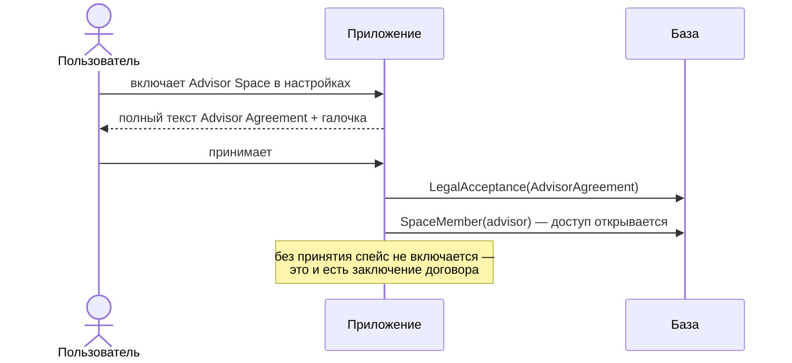

Тот же флоу — для Scout Space и любого будущего ролевого спейса. Меняется только код
шаблона.

### F7. Платная покупка (Checkpoint как образец)

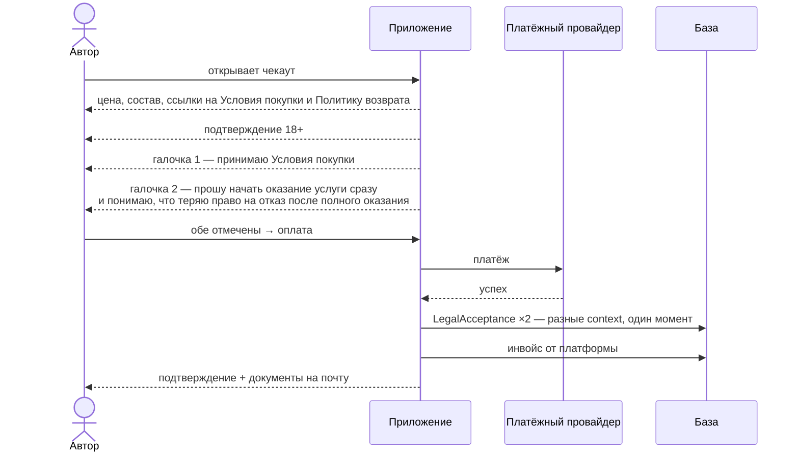

Две галочки — не перестраховка: без отдельного явного запроса на немедленное начало
оказания услуги право на отказ сохраняется полностью, и удержать стоимость оказанного
нельзя. Это единственное место, где галочек две.

### F8. Выдача сертификата из любого спейса

```mermaid
sequenceDiagram
    actor Org as Организатор / куратор
    participant App as Приложение
    participant Doc as legal.gdhub.io
    participant DB as База
    actor R as Получатель

    Org->>App: «выдать сертификаты» по списку участников
    loop каждый участник
        App->>DB: LegalInstance(kind=Credential), номер, рендер PDF
        App->>Doc: конверт: подписанты — организатор, наставник;<br/>получатель — копией
        Doc-->>Org: ссылка на подписание
    end
    Org->>Doc: подписывает
    Doc-->>App: вебхук «конверт закрыт»
    App->>Doc: скачивает подписанный PDF
    App->>DB: сохраняет файл, статус Issued
    App->>R: Novu · legal-credential-issued<br/>письмо, in-app и пуш
```

Список подписантов задаёт шаблон: у события — организатор и наставник, у курса —
преподаватель, у Checkpoint — куратор и платформа. Механика одна.

### F9. Проверка сертификата посторонним

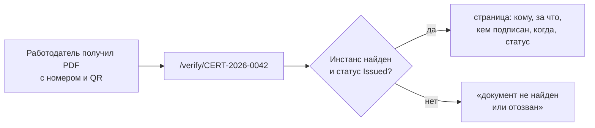

Страница публичная, без регистрации, показывает минимум персональных данных — имя,
предмет, дату, статус. Отзыв сертификата — смена статуса инстанса на `Void`, страница
начинает говорить об этом, а получатель узнаёт об этом от нас
(`legal-credential-revoked`), а не от того, кто пришёл проверять. Удалять нельзя: исчезнувшая страница неотличима от подделки.

### F10. «Мои документы»

Раздел в профиле: что пользователь принял, когда, в какой редакции; что подписал; что
ему выдано; что ждёт его действия. Каждая строка открывает **тот самый текст**, который
он видел, а не текущую версию.

Это же — ответ на запрос данных по GDPR и на любой спор: экспорт в один PDF.

---

## 7. Где это живёт в интерфейсе

| Точка | Что показывает |
|---|---|
| Футер | ссылки на все документы слоя 0 |
| `/legal` | список опубликованных документов, все версии, даты вступления |
| Регистрация | галочка слоя 0 |
| Гейт при входе | повторное принятие после существенного изменения |
| Включение спейса | галочка слоя 1 |
| Чекаут | галочки слоя 1 + возврат + 18+ |
| Проект → «Документы» | действующий инстанс, история, кто принял и когда |
| Профиль → «Мои документы» | F10 |
| `/verify/<номер>` | публичная проверка |
| Админка → `/admin/legal` | шаблоны, версии, публикация, заключённые документы, скачивание — §9 |

---

## 8. Уведомления

Юридический слой почти ничего не делает сам: он ждёт действия человека. Значит, каждое
ожидание должно до человека дойти. Рассылка идёт через **Novu** (`NovuService.send`) —
тем же способом, что и остальные уведомления платформы, с доставкой в приложение, на
почту и пушем, куда пользователь подписан.

**Правило:** уведомление отправляется там, где от человека ждут действия или где ему
выдали документ. Событие, которое просто попадает в историю, уведомления не порождает.

| Что произошло | Workflow | Кому | Каналы |
|---|---|---|---|
| От вас ждут принятия договора (приглашение, вакансия, смена долей) | `legal-acceptance-requested` | стороне | in-app + email |
| Вторая сторона приняла | `legal-acceptance-completed` | инициатору | in-app |
| Опубликована новая версия, существенное изменение | `legal-version-published` | всем затронутым, за 30 дней (15 — деловым) | email + in-app |
| Версия вступила в силу, вы ещё не приняли | `legal-reacceptance-required` | не принявшим | in-app + email |
| От вас ждут подписи | `legal-signature-requested` | подписанту, со ссылкой на legal.gdhub.io | email + in-app |
| Подпись всё ещё не поставлена | `legal-signature-reminder` | подписанту, на 3-й и 7-й день | email |
| Документ подписан всеми | `legal-signature-completed` | всем сторонам, со ссылкой на PDF | email + in-app |
| Выдан сертификат | `legal-credential-issued` | получателю | email + in-app + push |
| Сертификат отозван | `legal-credential-revoked` | получателю | email |
| Покупка оформлена: инвойс и принятые условия | `legal-purchase-documents` | покупателю | email |

Чего в уведомлении быть не должно:

- **текста документа** — в письме идёт название, версия и ссылка; текст живёт на
  платформе, где его открытие фиксируется;
- **действия вместо платформы** — принять договор по ссылке из письма нельзя, ссылка
  ведёт на экран, где принятие записывается со всеми полями (§3.2);
- **тишины при отказе доставки.** Если письмо не ушло, ожидание никуда не делось:
  сторона всё равно видит его в приложении и в «Моих документах».

Полезная нагрузка одинакова у всех workflow — `instanceId`, `documentTitle`, `version`,
`spaceTitle`, `deepLink`, `deadline`. Один шаблон письма закрывает половину таблицы.

**Открытый вопрос:** подписант не всегда зарегистрирован — приглашение по e-mail
приходит человеку без аккаунта. Либо `subscriberId` создаётся по e-mail заранее, либо
такие письма идут прежним транспортом. Решается вместе с задачей про оформление
транзакционных писем.


## 9. Админка

Три вещи, которых сегодня нет и без которых слой не работает: **создать шаблон**,
**увидеть, кто с кем что подписал**, **скачать файл**. Это раздел `/admin/legal`.

Он встаёт в существующий каркас админки без исключений: новая фича `legal: ["view",
"manage"]` в [src/config/spaces/admin.ts](../../src/config/spaces/admin.ts), пункт меню с
`permission: "admin.legal.view"` — так же, как Roles, Events и Workflows.

### 9.1 Три страницы

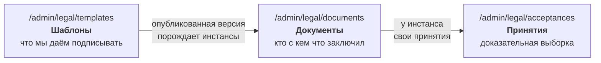

**Шаблоны** — список кодов документов, под каждым версии и локали. Что можно:

- создать новую версию: markdown-редактор, список параметров подстановки, локаль;
- **предпросмотр на тестовых параметрах** — увидеть текст глазами пользователя до
  публикации, иначе опечатка в подстановке обнаружится уже в подписанном документе;
- опубликовать: дата вступления, флаг «существенное изменение» (он включает гейт и
  рассылку из §8);
- архивировать: предыдущая версия уходит в `Archived` автоматически при публикации новой.

Чего нельзя и что интерфейс должен запрещать, а не полагаться на аккуратность:
**редактировать опубликованный текст**. Кнопки правки у `Published` нет — только
«создать следующую версию». На одну пару (код, локаль) в статусе `Published` всегда
ровно одна запись.

**Документы** — все `LegalInstance`, то есть заключённое, а не шаблоны. Строка таблицы:

| Колонка | Что в ней |
|---|---|
| Документ | код и версия шаблона |
| Спейс | проект, событие, курс — со ссылкой |
| Стороны | кто, в какой роли, статус каждой (`Pending` / `Accepted` / `Signed` / `Declined`) |
| Способ | галочка или подпись |
| Статус | `Active` / `Superseded` / `Void` / `Issued` |
| Дата | когда заключён или выдан |
| Действия | открыть текст, скачать PDF, история |

Фильтры: по коду документа, статусу, спейсу, участнику, диапазону дат, способу
подтверждения. Отдельный быстрый фильтр **«ждут действия»** — инстансы, где хотя бы одна
сторона `Pending` дольше недели; это рабочий список, а не отчёт.

Карточка одного документа: полный текст, каким его видели стороны; стороны со временем и
способом; журнал `LegalEvent`; кнопка скачивания подписанного PDF; для сертификата —
номер, ссылка на публичную страницу проверки и отзыв.

**Принятия** — плоский журнал `LegalAcceptance` со всеми доказательными полями:
пользователь, документ, версия, время (UTC), IP, user-agent, контрольная сумма текста,
контекст. Нужен ровно в двух случаях: спор и запрос регулятора. Отсюда — экспорт CSV и
поиск по пользователю.

### 9.2 Скачивание

Скачивается **наша копия**, сохранённая при закрытии конверта, а не файл по ссылке в
Documenso. Причина в §3.3: инстанс подписи свой, и документ не должен зависеть от его
доступности.

- один документ — PDF;
- выборка — zip по текущему фильтру, для сертификатов события или курса это основной путь;
- журнал принятий — CSV.

Каждое скачивание пишется в `AuditLog` (раздел Audit Logs уже есть): в этих файлах лежат
имена, доли и суммы, и «кто выгрузил договоры проекта» — вопрос, на который нужно уметь
ответить.

### 9.3 Что админ не может

Границы важнее возможностей, потому что весь смысл слоя — в неизменности записей:

- **редактировать опубликованный текст** — только новая версия;
- **удалять или править принятие и подпись** — запись о состоявшемся факте;
- **подписывать или принимать за пользователя** — даже «по его просьбе в переписке»;
- **менять стороны заключённого инстанса** — ошибка исправляется новым инстансом, старый
  уходит в `Void` с причиной;
- **выпускать сертификат задним числом молча** — дата выдачи ставится фактическая,
  а дата события берётся из события.

Отзыв сертификата, `Void` инстанса и публикация версии — три действия, которые требуют
`admin.legal.manage`, пишут причину и попадают в `AuditLog`.


## 10. Хранение и доказательства

- **Опубликованная версия не изменяется и не удаляется** — никогда, ни при каких
  обстоятельствах. Правка = новая версия.
- **Подписанный PDF хранится у нас**, а не только в Documenso.
- **Журнал** принятий и подписей пишется в `LegalEvent` и не редактируется из приложения.
- **Срок хранения** — не меньше срока исковой давности по договору плюс запас; конкретный
  срок подтверждает юрист (в Литве общий срок — десять лет). До подтверждения не удаляем
  ничего.
- **Удаление аккаунта не удаляет принятия.** Договор был заключён; запись о нём — то, чем
  подтверждается правомерность обработки. Персональные поля минимизируются, факт остаётся.

---

## 11. Чего мы сознательно не делаем

- **Не пишем свой сервис подписи.** Documenso или его замена.
- **Не строим систему управления договорами** (переговоры, редлайны, согласования).
- **Не смешиваем согласие на cookie с принятием оферты** — это разные основания и разные
  механизмы.
- **Не делаем трёхсторонних договоров**, пока не появится эскроу.
- **Не выпускаем верифицируемые бейджи** на старте — публичной страницы проверки хватает.
- **Не даём пользователям загружать свои шаблоны** до третьего этапа.
- **Не автоматизируем юридические выводы.** Платформа фиксирует, что произошло, и не
  решает, кто прав.

---

## 12. Этапы

**Этап 1 — привести к общему виду то, что есть.**
Обобщить `Project*`-модели до спейсов, добавить `LegalParty`, собрать реестр документов в
коде, публичные страницы `/legal`, галочка при регистрации и при включении спейса,
принятия с полным набором полей, workflow `legal-acceptance-requested` и
`legal-acceptance-completed` в Novu, раздел `/admin/legal` — шаблоны и список
заключённых документов со скачиванием (§9). Сертификаты остаются как есть.

**Этап 2 — подпись и видимость.**
Сертификаты переезжают на `LegalInstance` и выдаются из курсов и Checkpoint, а не только
из событий. Страница проверки. «Мои документы». Гейт повторного принятия. Подпись через
legal.gdhub.io для договора о совместной разработке, когда в нём есть доли, и
остальные workflow из §8 — версии, подписи, сертификаты.

**Этап 3 — по мере спроса.**
Документы между пользователями по своим шаблонам. Экспорт досье. Литовские версии.
Верифицируемые бейджи, если сертификаты начнут спрашивать снаружи.

---

## 13. Связанные документы

- [terms-of-use.md](terms-of-use.md) — общие условия (требует переиздания, см. open-points)
- [advisor-agreement.md](advisor-agreement.md) — договор с эдвайзером
- [checkpoint-terms.md](checkpoint-terms.md) — условия покупки Checkpoint
- [open-points.md](open-points.md) — что должен подтвердить юрист и бухгалтер
- [../refund-policy.md](../refund-policy.md) — политика возврата
- [../roles-and-permissions.md](../roles-and-permissions.md) — спейсы и роли
