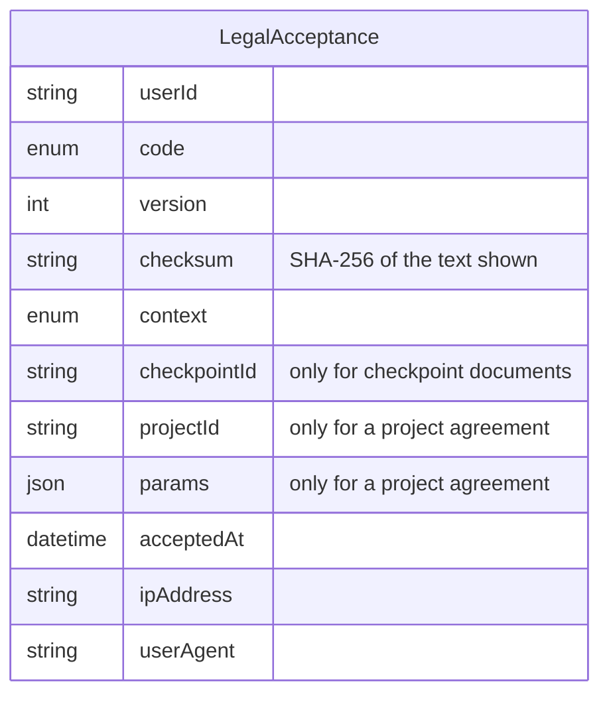

# Legal layer

How GDHub handles legal documents: what kinds exist, how each is agreed to, what is
stored, and what is deliberately not built. The texts themselves live next to this file
([terms-of-use](terms-of-use/v1.md), [advisor-agreement](advisor-agreement/v1.md),
[checkpoint-purchase-terms](checkpoint-purchase-terms/v1.md)); open legal points are in
[open-points.md](open-points.md).

Revision 2 — 2026-10-17. Replaces the September draft, which had four layers, per-user
instances, parties, signatures, an admin editor and ten notification workflows. Almost all
of that existed for agreements nobody concludes yet; this revision keeps what proves an
acceptance and drops the rest until a real case asks for it.

The logic — who accepts what, where the server refuses, how versions and shares move — is
drawn in [legal-layer-flow.d2](legal-layer-flow.d2) ([svg](legal-layer-flow.svg)).

## 1. Principles

1. **Texts are files, acceptances are rows.** Every version of every document is a
   markdown file in this folder; the database holds only who accepted which version. Who
   still has to accept, a user's history — a query over that one table.
2. **A published version never changes.** A correction is a new file. An acceptance
   records the version and the checksum of the file the user was shown.
3. **A tick, not a signature.** Every document a user agrees to on GDHub is accepted with
   a checkbox and recorded with evidence. A signature is added only when someone outside
   the platform (an investor, a court) actually asks for one.
4. **The server enforces it.** A screen that hides the checkbox cannot get past the
   endpoint: payment, project creation and switching a space on refuse without the
   acceptance.
5. **Certificates are not agreements.** Nobody accepts a certificate; it is a fact the
   platform issued, proven by its public verification page.

## 2. Kinds of documents

| Kind | Documents | Agreed when | Linked to |
|---|---|---|---|
| Platform offer | Terms of Use, Project Requirements, Advisor Agreement; later Course and Event terms | sign-up, project creation, switching the Advisor space on | — |
| Paid expert work | Expert Services Terms | Advisor space → Settings → Paid work, before paid consultations or curation — together with payout details | — |
| Checkpoint | Purchase Terms and the withdrawal waiver (author); Checkpoint Standard (curator) | the author pays; the curator accepts that checkpoint | `checkpointId` |
| Project agreement | Co-Development Agreement (shares, IP, exit) | a member is given a share for the first time, or their share changes | `projectId` |
| Certificate | event certificate today | issued, not accepted | its source |

Privacy Policy, Cookie Policy, Refund Policy and Legal Details are **published and
versioned but never accepted**: privacy is notice, cookies are the banner's own consent,
refunds are part of the purchase terms. Sign-up records exactly one acceptance — the Terms
of Use.

Every kind except the certificate is the same mechanism with a different code.

**The advisor role is three documents, one for each moment the obligations change.** The
Advisor space is where consultations (free and paid) and curation happen. The Advisor
Agreement (status, conduct, AI, confidentiality, data, volunteering) opens the space and
with it free consultations. Expert Services Terms (fees, the platform's cut,
payouts, invoicing or self-billing, withholding, refunds) open paid consultations and
curation, and are accepted together with payout details, because getting paid needs both.
The Checkpoint Standard in force on the day a checkpoint starts is accepted by its curator
for that checkpoint. There is no separate "curator terms" document.

## 2a. Legal entities

Entities live in `src/config/legal/entities.ts`: today the Lithuanian non-profit VšĮ
Žaidimų Kūrėjų Hubas and the founder's Georgian sole proprietorship (decided 2026-10-17).
Each **hub space** names the entity it operates under (`HUB_LEGAL_ENTITIES`; only
`default` exists, under the VšĮ) — a new hub brings its own. Each **document** names its
issuer in the registry: `"hub"` (the hub's entity) or a specific one, so one document can
come from the VšĮ and another from the founder. The texts name the issuer through
placeholders (`{{entity.name}}`, `{{entity.code}}`, `{{entity.email}}`, …) filled in when
the text is shown.

Changing an issuer must not rewrite a text someone already accepted, so **each version
records the entity it was published under**. Archived versions keep naming the old one;
switching is a config change plus a new version of every document it issues, and a test
fails while a document in effect names an entity other than its issuer. The checksum is
taken over the text as shown — file plus entity — and the Legal Details page reads the
hub's entity.

**The currency belongs to the entity.** A Lithuanian or other EU entity would charge in
euro, so `currency` (ISO code, e.g. `USD`) sits on the entity, not in each feature. The
checkpoint config (`CHECKPOINT_CURRENCY`, today its own `"USD"` and `"$"`), Stripe
checkout, the consultation price and the texts (`{{entity.currency}}`) all read it, and
amounts are shown with `Intl.NumberFormat` from that code, never a hardcoded symbol.
Switching currency is still a decision, not a flag: the price amounts in config are
restated at the same time, and the documents in effect get new versions like any entity
change.

## 3. Texts and data

**Texts.** `docs/legal/<slug>/v<n>.md`, one file per version, never edited after it is
published. A registry in code (`src/config/legal`) lists each document: code, slug, title,
where it is accepted (or that it is never accepted), and its versions with effective date,
`materialChange`, the entity it names and the SHA-256 of the text as shown. Publishing a version is a pull request that adds
the file and the registry entry; a test fails if a published file no longer matches its
checksum, so "never edited" is enforced, not hoped for.

**Data — one table.**



- **One row per (user, code, context, checkpoint/project).** The withdrawal waiver is its
  own code, not a flag, because it is a separate declaration with its own checkbox.
- **The server takes `{code, version}` from the form** and refuses a version that is not
  the one in effect, so the row never names a text the user did not see.
- **A project agreement is something a project switches on (decided 2026-10-17, not
  built yet).** Most teams have no agreement and no shares, and an invitation carries no
  share, so joining a team concludes nothing: invites and offers stay as they are. The
  switch is the existing `Project.usesCoDevelopmentAgreement` (false by default), turned
  on in the project settings — and later possibly chosen at creation, as the
  `feat/legal-codev` branch (May 2026) did. While it is off, no shares are given and the
  Co-Development Agreement is not mentioned anywhere in the project. Turning it on is the
  author accepting the agreement; each member accepts it when given a share, and again
  when the share changes.
- **Its text exists as a draft**: `docs/co-development-agreement.md` in `feat/legal-codev`
  (Russian; `{{ projectName }}`, `{{ authorName }}`, `{{ agreementDate }}`,
  `{{ platformShare }}`, `{{ mentorFundShare }}`, and an ``
  block). It needs an English version, `{{params.*}}` placeholders, and conditional
  sections either dropped or supported by the renderer, which today fills placeholders only.
- **A project agreement** is a markdown template filled in with the project's title and
  shares. Its row carries `projectId` and the filled-in values (`params`), so template
  version + params reproduce the exact text, and the checksum is over that text. Changing
  shares is new params; each member accepts them with a new row, and until they do the
  previous row stays in force for them.
- **Shares and equity (decided 2026-10-17).** The equity tables (`EquityAllocation`,
  `EquityTransaction`, `EquityPromise`) keep working as they do: a transaction changes the
  bookkeeping at once. What binds a member is the share in their latest accepted
  agreement; until they accept a new one, the new share is shown as "not accepted yet"
  and the old one as in force. Vesting of a promise already in the accepted params needs
  no new acceptance.
- **What replaces the stopgaps.** `User.agreements.agreeWithTermsAndPrivacy` (a boolean
  with no version or time) becomes the Terms acceptance; `ProjectCheckpoint.acceptedTermsAt`
  and `acceptedTermsTemplateId` become two acceptances with `checkpointId`. The newsletter
  flag stays in `User.agreements` — it is marketing consent, not a document.
- **What the old tables become.** `LegalDocumentTemplate`, `ProjectLegalSnapshot`,
  `ProjectLegalEvent` go; `LegalAcceptance` is reshaped as above. The app never wrote to
  them, so nothing migrates (checked with a count in production before the change).

## 4. Lifecycle

A version exists from the day its file is merged; it is **in effect** from its effective
date until the next version's. Exactly one version per document is in effect at any
moment; the others are archived and still readable at `/legal/<slug>/v<n>`.

- Relationships run on the version they started under: a running checkpoint, a member's
  project agreement.
- A **material** change asks users to accept again: an email when it takes effect, and a
  check at the next sign-in that the version in effect is accepted.
- A non-material change (a typo, a link) asks nothing.

## 5. Where it shows

| Place | What |
|---|---|
| `ClickwrapField` | the one checkbox used everywhere: never pre-ticked, names the document, links to the exact version, error under it |
| Sign-up | Terms of Use |
| Create project | Project Requirements |
| Advisor space switch-on | Advisor Agreement; the space does not open without it |
| Checkpoint pay step | Purchase Terms + withdrawal waiver, two checkboxes |
| Advisor space → Settings → Paid work | Expert Services Terms + payout details; paid consultations and curation stay off until both are done |
| Curator accepting a checkpoint | Checkpoint Standard |
| `/legal`, `/legal/<slug>`, `/legal/<slug>/v<n>` | every published document, its current text and its archived versions; old URLs 308 here |
| `/admin/legal` | the acceptances log with filters and CSV export (written to `AuditLog`) |
| Share given or changed (team page) | Co-Development Agreement with the project's values filled in; invites and offers carry none |
| Sign-in after a material change | a gate: what changed, the full text, accept to continue |
| Profile → My documents | what the user accepted, each opening the exact text; certificates issued to them |
| `/verify/<number>` | every certificate |

## 6. Certificates

`EventCertificate` widens to `Certificate` with a source (event, course, checkpoint), a
public number and the existing `/verify` page. Event certificates keep their Documenso
signature, so the issued ones keep working; a new kind needs no signature, because the
verification page is what proves it.

## 7. Not built, and when it would be

- **Signatures for agreements** — when an investor or a court asks for a signed co-development
  agreement. The signed PDF is then attached to the version; the model does not change.
- **Per-agreement instances, parties, a registry of concluded documents, Void, PDF and zip
  exports** — when user-to-user agreements need more than "who accepted which version".
- **Three-party agreements** — two two-party agreements referring to each other instead.
  Checkpoint already works that way: the author buys from the platform, the curator works
  for the platform, author and curator have no contract.
- **An admin editor for texts** — while a lawyer and a pull request are the way a text
  changes, a file is the simpler and better-audited home for it.
- **User-supplied templates, Lithuanian versions, verifiable badges** — on demand.
- **Notification workflows** beyond two: a material version taking effect (email), and a
  share waiting for a member's acceptance.
- **Legal conclusions.** The platform records what happened; it does not decide who is right.

## 8. Order inside the work

All of the above is one piece of work (GDHUB-54). The checkpoint pay step goes first,
because launch is blocked on it; the rest follows in any order.

## 9. Retention

Nothing in the acceptances table is deleted, and no published file is removed: an acceptance is the record that a contract was
concluded. Deleting an account minimises personal fields on the user, not the acceptance.
The retention period is for the lawyer to confirm (Lithuania's general limitation period
is ten years); until then nothing is removed.

## 10. Schema change (`../prisma`)

Proposed against `dev` of gdhub-prisma (2.0.0-beta.67). One release, then the app bumps.

**Removed** — never written by the app (a production count confirms it before the
release): `LegalDocumentTemplate`, `ProjectLegalSnapshot`, `ProjectLegalEvent`, the enums
`LegalDocumentCode`, `LegalTemplateStatus`, `ProjectLegalSnapshotStatus`, `LegalActorRole`,
`LegalAcceptanceContext`, `ProjectLegalEventType`; the relations
`Project.activeLegalSnapshot*`, `Project.legalSnapshots`, `Project.legalEvents`,
`TeamMember.joinedUnderSnapshot*`, `TeamMember.legalEvents`, the `User` snapshot and event
relations; `ProjectCheckpoint.acceptedTermsAt` / `acceptedTermsTemplateId` /
`acceptedTerms` (replaced by acceptance rows; a checkpoint already paid on beta keeps its
timestamp copied into a row by the migration).

**`LegalAcceptance`, reshaped:**

```prisma
model LegalAcceptance {
  id           String   @id @default(cuid())
  userId       String
  /// Registry code (`src/config/legal`), e.g. "TermsOfUse". A string, not an enum:
  /// a new document is a registry entry in the app, not a schema release.
  code         String
  version      Int
  /// SHA-256 of the text as shown: file + entity + params.
  checksum     String
  /// Registry context: SignUp, ProjectCreate, AdvisorJoin, ExpertServices,
  /// CheckpointPurchase, CuratorAccept, ShareChange, ReAcceptance.
  context      String
  checkpointId String?
  projectId    String?
  /// Filled-in values of a project agreement (title, shares).
  params       Json?
  ipAddress    String?
  userAgent    String?
  acceptedAt   DateTime @default(now())

  /// Restrict: an acceptance outlives everything it points at.
  user       User               @relation(fields: [userId], references: [id], onDelete: Restrict)
  checkpoint ProjectCheckpoint? @relation(fields: [checkpointId], references: [id], onDelete: SetNull)
  project    Project?           @relation(fields: [projectId], references: [id], onDelete: SetNull)

  @@index([userId, code])
  @@index([checkpointId])
  @@index([projectId, code])
  @@index([acceptedAt])
}
```

No unique constraint: the same user may accept the same version twice in different
contexts or projects, and a double submit is harmless evidence. The app checks
"accepted?" by query.

**`Certificate`, replacing `EventCertificate`:**

```prisma
enum CertificateSource {
  Event
  Course
  Checkpoint
}

model Certificate {
  id            String            @id @default(cuid())
  number        String            @unique
  source        CertificateSource
  userId        String
  eventMemberId String?           @unique
  courseGroupStudentId String?    @unique
  checkpointId  String?
  /// Documenso envelope — event certificates only.
  externalId    String?           @unique
  issuedAt      DateTime
  revokedAt     DateTime?
  createdAt     DateTime          @default(now())
  updatedAt     DateTime          @updatedAt

  user               User                @relation(fields: [userId], references: [id], onDelete: Restrict)
  eventMember        EventMember?        @relation(fields: [eventMemberId], references: [id], onDelete: SetNull)
  courseGroupStudent CourseGroupStudent? @relation(fields: [courseGroupStudentId], references: [id], onDelete: SetNull)
  checkpoint         ProjectCheckpoint?  @relation(fields: [checkpointId], references: [id], onDelete: SetNull)

  @@unique([checkpointId, userId])
  @@index([userId])
}
```

The migration copies every `EventCertificate` row into `Certificate` (same number,
`source = Event`, `userId` from the event member) and drops the old table — issued numbers
keep verifying.

**`ExpertProfile`, new — the Paid work section:**

```prisma
enum ExpertInvoicing {
  SelfEmployed
  Company
  SelfBilling
}

model ExpertProfile {
  id                 String           @id @default(cuid())
  userId             String           @unique
  payoutHolder       String?
  payoutAccount      String?
  invoicing          ExpertInvoicing?
  paidConsultations  Boolean          @default(false)
  /// Minor units, in the entity's currency.
  consultationPrice  Int?
  curation           Boolean          @default(false)
  createdAt          DateTime         @default(now())
  updatedAt          DateTime         @updatedAt

  user User @relation(fields: [userId], references: [id], onDelete: Cascade)
}
```

**`User.agreements`** keeps its JSON for the newsletter and `confirmUserData` flags;
`agreeWithTermsAndPrivacy` stops being read (Terms acceptance rows replace it). Existing
users get no back-filled acceptance — there is no evidence to back-fill — and meet the
re-acceptance screen at their next sign-in.

**Erasure (`deleteUserPersonalData`), decided 2026-10-17.** `LegalAcceptance` rows stay,
IP and user-agent included, until the retention period ends (legal-claims basis); they are
not written to `AuditLog`. `Certificate` and `ExpertProfile` rows are deleted — a
certificate without a name proves nothing, and `/verify` then answers "not found".
