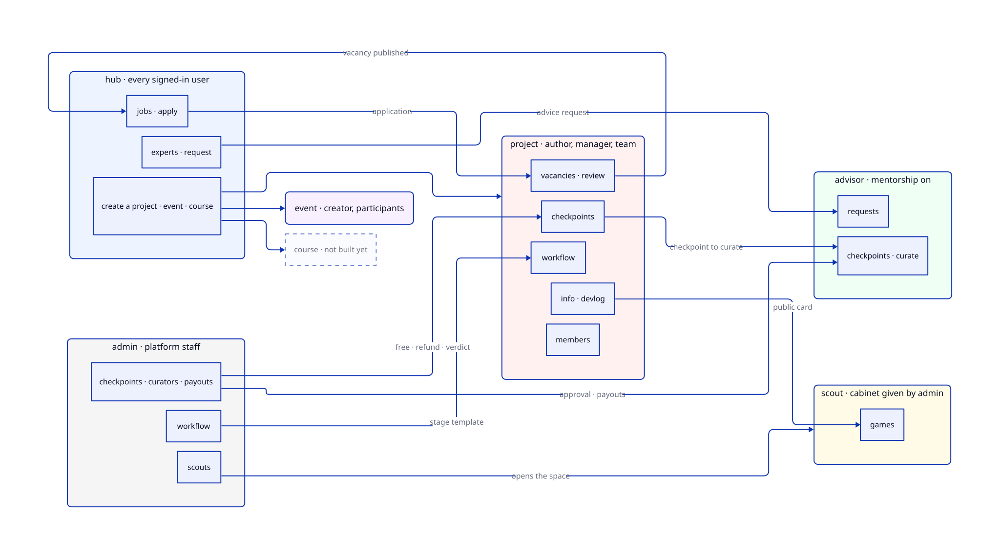

# Spaces

What GDHub is made of: eight spaces, the features inside each one, how the spaces
feed each other, and who may do what. Read this first when you need to know what a
change touches or what has to be tested, and from whose side.

Source of truth, in this order:

| What | Where |
|---|---|
| Spaces, features, actions, role overrides | [src/config/spaces](../src/config/spaces) — `defineSpace` per space |
| Every role × permission cell | [roles-and-permissions-matrix.md](roles-and-permissions-matrix.md) — generated, `bun run rbac:matrix-doc` |
| How roles and permissions work | [roles-and-permissions.md](roles-and-permissions.md) |
| Every screen, numbered | [platform-map.md](platform-map.md) — the `03.04`-style numbers below |

This page does not copy the matrix. It names the feature and the permission; the
matrix says which role holds it.

[tests/spaces-doc.test.ts](../tests/spaces-doc.test.ts) keeps this page honest: it
fails when a space, a feature or a page under `src/app/(app)/(spaces)` is missing
here, and when the [unchecked list](#declared-not-yet-checked-anywhere) no longer
matches the code.

## How access works, in four lines

1. **Entering a space** is decided by the role, never by a permission. The space's
   `layout.tsx` is `createSpaceGate(type)`: no role, **404**. The hub alone has no
   gate of its own: a session is enough.
2. **Inside a space** a permission (`space.feature.action`) guards each page and API
   route: `createPermissionGate` on a page, `withSpaceGuard` on a route. Missing: 404
   on a page; on the API 404 when the caller has no role, 403 when the role lacks
   the permission.
3. **Defaults by action class** ([roles-and-permissions.md §3.5](roles-and-permissions.md)):
   reading goes to every member, managing to owner and admin, destroying to the owner.
   A **guest** gets nothing unless the space lists it.
4. A hub role never opens somebody else's project, event or course. Only the super
   admin crosses that line, and it is written to the audit log.

## The spaces at a glance

| Space | Who is in it, and as what | Entry page |
|---|---|---|
| [hub](#hub) | everyone signed in: guest until onboarding, then member; platform staff are admin | `/hub` |
| [project](#project) | author = owner, invited manager = admin, hired team member = member | `/user/project/[slug]` |
| [event](#event) | creator = owner, manager = admin, approved participant = member | `/user/event/[eventId]` |
| [course](#course) | author = owner, teacher = admin, student = member | `/user/course/[courseId]` |
| [advisor](#advisor) | anyone with a speciality open for mentoring = owner | `/advisor` |
| [scout](#scout) | anyone with a scout cabinet (created by admin) | `/scout` |
| [admin](#admin) | inherited: hub admin and above | `/admin/users` |
| [dev](#dev) | inherited: hub admin and above; **absent in production** | `/dev/ui-test` |

Outside every space: the **public** pages (no sign-in), the **account** pages
(sign-in, registration, onboarding, invitations) and the **personal** pages, which
need a session and nothing else: `/user/settings`, `/user/settings/[item]`,
`/user/events`, `/user/courses`, `/user/advice-requests`, `/profile`.

---

## hub

The community: catalogues of everything public, and the doors into the other spaces.
Screens `03.*`.

| Feature | Actions | Pages | Links |
|---|---|---|---|
| `projects` | view, create | `/hub/projects` | lists **project** spaces; *create* opens a new one (the creator becomes its owner) |
| `jobs` | view, apply | `/hub/jobs`, public `/jobs`, `/job/[id]` | shows **project** `vacancies`; *apply* lands in the project's `vacancies.review` |
| `experts` | view, request | `/hub/experts`, public `/expert/[id]` | shows **advisor** profiles; *request* lands in the advisor's `requests` |
| `events` | view, create | `/hub/events`, public `/events`, `/event/[slug]` | lists **event** spaces; *create* needs a speciality at the expert level (staff exempt) |
| `courses` | view, create | `/hub/courses`, `/hub/courses/[slug]`, public `/course/[slug]` | lists **course** spaces |
| `talent_pool` | view, contact | `/hub/members` | people's profiles; *contact* opens a chat |
| `chat` | use | the header launcher, `/chat` | cross-space, see [Shared features](#shared-features) |
| `live_room` | use, manage | `/live/room/reports` | member is denied `use` by override: staff only today |

Guests (not onboarded) see the `projects`, `events`,
`courses`, `jobs` and `experts` catalogues, and nothing else.

## project

A team making one game. Screens `04.*`, checkpoints `12.*`.

| Feature | Actions | Pages | Links |
|---|---|---|---|
| `info` | view, edit | `/user/project/[slug]`, `/user/project/[slug]/settings/*`; public `/project/[slug]` | public card read by **hub** and **scout** |
| `lifecycle` | archive, delete | `/user/project/[slug]/settings/*` (danger zone) | — |
| `members` | view, invite, remove | `/user/project/[slug]/team`, `/invite/[token]` | invitee comes from anywhere; accepted, they become a member |
| `vacancies` | view, manage, review | `/user/project/[slug]/open-positions` | *gives* jobs to **hub**; paid listings through Paddle; *review* turns an applicant into a member |
| `workflow` | view, edit | `/user/project/[slug]/workflow` | template comes from **admin** `workflow`; an active checkpoint locks it |
| `checkpoints` | view, create, manage | `/user/project/[slug]/workflow/[cp]`, `/user/project/[slug]/workflow/cp/new`, `/checkpoint/new/*` | curator from **advisor** (or the AI); run from **admin** `checkpoints`; paid through Paddle; certificate at public `/verify` |
| `room` | use, manage | the call room inside a checkpoint | Daily; nobody inside the project has `manage` |
| `artifacts` | view, manage | `/user/project/[slug]/artifacts` | proof of checkpoint tasks; checkpoints read artifacts, never the reverse |
| `devlog` | view, create, publish, manage (member: own posts) | `/user/project/[slug]/devlog`; public `/devlog/[id]` | public, applause from **hub** members; moderated by **admin** `devlog_posts` |
| `equity` | view, manage | inside `/user/project/[slug]/team` | a member sees only their own share (`own`) |

Overrides worth knowing: only the **owner** may buy a checkpoint (`checkpoints.create`,
`checkpoints.manage` are off for admin and member). Guests see `info` and `devlog`.

## event

A conference or a game jam. Screens `06.*`.

| Feature | Actions | Pages | Links |
|---|---|---|---|
| `info` | view, edit | `/user/event/[eventId]`, `/user/event/[eventId]/settings/*`; public `/event/[slug]` | listed in **hub** `events` |
| `lifecycle` | publish, archive, delete | `/user/event/[eventId]/settings/*` | publishing puts it on the public pages |
| `schedule` | view, edit | `/user/event/[eventId]/schedule` | — |
| `content` | view, edit | `/user/event/[eventId]/content` | — |
| `members` | view, manage | `/user/event/[eventId]/members` | a jam participant brings a **project** |
| `certificates` | view, issue | `/user/event/[eventId]/members` | public `/verify/[number]` |

Guests see `info` and `schedule`.

## course

A paid course with groups and a classroom. Screens `05.*`. **Mostly not built:**
`/user/course/[courseId]` says "In development".

| Feature | Actions |
|---|---|
| `info` | view, edit |
| `lifecycle` | publish, delete |
| `curriculum` | view, edit |
| `classroom` | access, teach |
| `students`, `groups` | view, manage |
| `content` | view, edit |
| `certificates` | view, issue |

Listed in **hub** `courses`; public page `/course/[slug]`.

## advisor

An expert's cabinet: advice requests, checkpoints they curate, their time and money.
Screens `08.*`, `12.13`. Opened by switching mentorship on for a speciality
(`/user/settings`, `08.11`). The Advisor Agreement (`11.06`–`11.08`) is asked for at
that switch; the gate itself checks only the speciality today.

| Feature | Actions | Pages | Links |
|---|---|---|---|
| `requests` | view, manage | `/advisor/requests` | *gets* requests from **hub** `experts`; the asker follows them at `/user/advice-requests`; each one is a chat |
| `checkpoints` | view, manage | `/advisor/checkpoints`, `/advisor/checkpoints/[id]`, `/advisor/checkpoints/[id]/review/[index]`, `/advisor/earnings` | curates **project** checkpoints; approved and paid by **admin** `curators`, `payouts` |
| `calendar` | view | `/advisor/calendar` | one availability for consultations and checkpoint calls |
| `settings` | view, manage | `/advisor/settings` | — |

## scout

An investor or publisher looking for games. Screens `09.*`. The cabinet, and with it
the space, is created by **admin** `scouts`.

| Feature | Actions | Pages | Links |
|---|---|---|---|
| `games` | view | `/scout/games` | reads public **project** cards and checkpoint provenance |
| `deals` | view, create, manage | planned | will open a chat with the project |
| `team` | view, invite, remove | planned | — |
| `settings` | view, manage | `/scout/settings/*` | — |

## admin

Running the platform. Screens `10.*`, `11.17`, `12.11`, `12.13`. Role inherited from
the hub: hub admin = admin, hub owner = owner.

| Feature | Pages | Reaches into |
|---|---|---|
| `users`, `roles` | `/admin/users`, `/admin/roles` | every space's role matrix |
| `posts` | `/admin/posts`, `/admin/post/[id]` | public `/blog` |
| `devlog_posts` | `/admin/devlog-posts` | **project** `devlog` |
| `events` | `/admin/events` | **event** |
| `projects` | via users and workflows | **project** |
| `scouts` | `/admin/scouts` | creates **scout** cabinets |
| `workflow` | `/admin/workflows`, `/admin/workflow/[id]`, `/admin/project-workflow/[id]` | **project** `workflow` |
| `checkpoints` | `/admin/checkpoints` | **project** `checkpoints`: promo codes, refunds, verdicts, free checkpoints |
| `curators` | `/admin/checkpoints` (curator tab) | **advisor**: who may curate |
| `payouts` | `/admin/payouts` | **advisor** earnings |
| `audit_logs`, `legal`, `views` | `/admin/audit-logs`, `/admin/legal`, `/admin/views` | read-only |

`payouts` and `curators` are **owner only** (off for admin by override).

## dev

Internal tools, one feature, `tools` (`dev.tools.use`): `/dev/ai-curator`,
`/dev/ai-validation`, `/dev/push-test`, `/dev/talent-graph`, `/dev/telegram-test`,
`/dev/test-seo`, `/dev/ui-test`. The space does not exist in production.

---

## Links between spaces

Each row is a feature one space hands to another. This is also the list of
**two-sided** e2e flows: each one needs both personas, each in its own browser context.

| From | Feature | To | What crosses | Personas |
|---|---|---|---|---|
| project | `vacancies` | hub `jobs` | a published vacancy; an application back | author ↔ member |
| hub | `experts` | advisor `requests` | an advice request, then a chat | member ↔ advisor |
| project | `checkpoints` | advisor `checkpoints` | the curated checkpoint: calls, reviews, verdict | author ↔ advisor |
| admin | `checkpoints`, `curators`, `payouts` | project, advisor | free checkpoints, refunds, curator approval, payouts | super admin ↔ author, advisor |
| admin | `workflow` | project `workflow` | the stage template | super admin → author |
| admin | `scouts` | scout | the cabinet, so the space exists | super admin → scout |
| project | `info`, `checkpoints` | scout `games` | the public card and who closed each stage | author → scout |
| project | `devlog` | hub, public | public posts, applause, views | author ↔ member |
| admin | `devlog_posts`, `posts` | project, public | moderation, blog | super admin → everyone |
| project | `members` | anyone | an invitation, accepted | author ↔ member |
| event | `members` | project | a jam participant's project | organiser ↔ author |
| event, project | `certificates`, `checkpoints` | public `/verify` | a certificate anyone can check | — |
| hub | `projects`, `events`, `courses` `create` | project, event, course | a new space with its creator as owner | member, organiser, educator |

## Shared features

Used by several spaces, owned by none.

| Feature | Used by | Doc |
|---|---|---|
| Chat (Matrix) | hub `talent_pool`, advisor `requests`, project `vacancies`, scout `deals` (planned) | [chat-system.md](chat-system.md) |
| Legal acceptances | registration, project creation, advisor switch-on, checkpoint purchase | [legal/legal-layer.md](legal/legal-layer.md) |
| Payments (Paddle) | project `vacancies` (paid listings), project `checkpoints` | [paid-vacancies.md](paid-vacancies.md), [checkpoints.md](checkpoints.md) |
| Notifications (Novu, email) | every space | — |
| Calendar subscription | project `checkpoints`, advisor `calendar` | [checkpoint-calendar.md](checkpoint-calendar.md) |
| AI validation and the AI curator | onboarding, project forms, project `checkpoints` | [ai-costs.md](ai-costs.md) |

## Declared, not yet checked anywhere

These permissions are in the registry but no page, route or component under `src/`
names them. Either the feature is not built, or the check is missing. Smoke tests
should treat the first kind as "no page yet" and the second as a bug.

The test fails when this list and the code disagree, so it only shrinks: wire a
check, then delete its line here.

- **hub:** `hub.projects.create`, `hub.jobs.apply`, `hub.courses.view`, `hub.courses.create`, `hub.chat.use`
- **project:** `project.members.view`, `project.lifecycle.archive`, `project.lifecycle.delete`, `project.workflow.view`, `project.vacancies.view`, `project.devlog.view`, `project.devlog.publish`, `project.room.manage`
- **event:** `event.content.view`, `event.content.edit`, `event.schedule.view`
- **course:** `course.info.view`, `course.info.edit`, `course.lifecycle.publish`, `course.lifecycle.delete`, `course.curriculum.view`, `course.curriculum.edit`, `course.classroom.access`, `course.classroom.teach`, `course.students.view`, `course.students.manage`, `course.groups.view`, `course.groups.manage`, `course.content.view`, `course.content.edit`, `course.certificates.view`, `course.certificates.issue`
- **scout:** `scout.deals.create`, `scout.deals.manage`, `scout.team.invite`, `scout.team.remove`
- **advisor:** `advisor.requests.manage`, `advisor.checkpoints.manage`, `advisor.settings.manage`

## Smoke test personas

[tests/personas.ts](../tests/personas.ts), signed in through `/dev-signin`. Each one
opens a different set of spaces, which is what the smoke matrix (GDHUB-130) walks.

| Persona | Spaces it may enter |
|---|---|
| anonymous | public pages only |
| `unonboarded` | hub as guest |
| `member` | hub |
| `author` | hub, own project (owner) |
| `advisor` | hub, advisor |
| `scout` | hub, scout |
| `organiser` | hub, own event (owner) |
| `educator` | hub, own course (owner) |
| `hubAdmin` | hub (admin), admin, dev |
| `superAdmin` | everything, including other people's projects |

Every space page that a persona may not enter must answer **404**, never a blank
page or another user's data.
